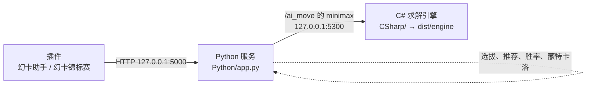
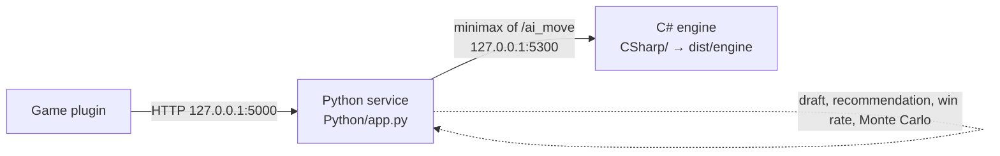

<div align="center">


# TTC_Siren

**《最终幻想 XIV》九宫幻卡 AI 求解服务 · Triple Triad AI solver for Final Fantasy XIV**

[](Python)
[](CSharp)
[](#性能--performance)
[](docs/API.md)
[](#快速开始)
[](docs/migration/CSHARP_MIGRATION.md)
[](#测试--tests)


[中文](#中文) · [English](#english)

</div>

---

<a id="中文"></a>

## 中文

面向《最终幻想 XIV》九宫幻卡的自动对战求解器。本地服务把插件识别到的棋盘、手牌、规则转换为出牌建议；
`/ai_move` 的 minimax 搜索由 **C# 引擎**完成——与 Python 原实现**逐位一致**，速度约为 Python 的 **30～260 倍**。

> [!TIP]
> 只想用？下载发布包 `TTC_Siren_release.zip`，解压后双击 `TTC_Siren.exe`，插件地址填 `http://127.0.0.1:5000`。不需要 Python、.NET 或密钥。

### 核心能力

- **Minimax + Alpha-Beta 搜索**：迭代加深、置换表、历史启发和走法排序，由 C# 引擎执行（服务启动时自动拉起，关闭时一起退出）。
- **信息集残局求解**：空位较少且未知牌不超过 2 张时，构造多个可能世界并完整搜索到终局。
- **合法未知牌枚举**：残局从全卡库枚举符合当前已知信息的候选，排除已出现卡牌，并应用卡组限制。
- **隐藏手牌建模**：前中局使用规则相关采样，高风险局面会扩大对手候选池。
- **规则适配评估**：基础翻面、同数、加算、逆转、王牌杀手、同类强化/弱化、秩序、混乱等。
- **选拔分析**：`/api/draft/analyze` 对选拔三选一做深算推荐；另有 NPC 卡组推荐与胜率估算。
- **实时速度显示**：控制台显示搜索深度、节点数、NPS、置换表命中率和残局信息集进度。

### 架构



请求解析、未知牌采样、选拔分析、文字分析都保持 Python 原实现；只有 minimax 搜索交给 C# 引擎。引擎只监听本机，不对外开放。

### 支持的规则

| 规则 | 状态 |
| --- | --- |
| 基础大小翻面 | 支持 |
| 同数 / 加算 | 支持，特殊翻面后才触发连携 |
| 逆转 | 支持 |
| 王牌杀手 | 支持，且仅处理 1 与 A(10) 的特殊克制 |
| 同类强化 / 同类弱化 | 支持，场上同类型卡牌数量决定修正层数 |
| 全明牌 / 三明牌 | 支持输入侧明牌/未知牌建模 |
| 秩序 / 混乱 | 支持 `canUse` 手牌可用性 |
| 选拔 | 有采样建模，仍建议结合实战验证 |

卡组限制按官方规则处理：**★4 以上卡牌合计不超过 2 张，★5 卡牌最多 1 张**。

### 求解流程

1. 服务端解析客户端传入的棋盘、我方手牌、对手手牌、当前玩家和规则。
2. 已知卡牌通过四边数值匹配数据库 ID，未知牌用 `0,0,0,0` 表示。
3. 前中局使用 Minimax 搜索，并对未知牌进行规则相关采样。
4. 进入残局时，如果满足空位较少且未知牌不超过 2 张：
   - 从全卡库枚举合法未知牌候选；
   - 按当前棋盘威胁排序并构造有限数量的信息集场景；
   - 对每个我方候选走法在所有场景中搜索到终局；
   - 按安全比例、最坏收益和综合收益覆盖标准搜索结果。
5. 返回推荐卡牌、位置、对手手牌分析、胜率估计和性能统计。

### 快速开始

**发给别人用的版本**：解压 `TTC_Siren_release.zip`，双击 `TTC_Siren.exe`（`engine` 文件夹要和它放在一起）。

**从源码运行**（Windows，Python 3.8+；第一次启动需要 .NET 10 SDK 来构建引擎）：

```bash
pip install -r Python/requirements.txt
python app.py
```

第一次启动会把 C# 引擎构建到 `dist/engine`，之后直接启动。服务监听 `http://127.0.0.1:5000`。

> [!NOTE]
> 设置环境变量 `TTC_CS_ENGINE=off` 可改用原来的 Python 搜索（慢约 100 倍）。部署、Windows 服务与引擎参数见 [`docs/DEPLOY_WINDOWS.md`](docs/DEPLOY_WINDOWS.md)。

**打包**

| 命令 | 产物 |
| --- | --- |
| `Python\scripts\build_release.bat` | 最小发布包：`dist\release\`（`TTC_Siren.exe` + `engine\`）和 `dist\TTC_Siren_release.zip` |
| `Python\scripts\build_all.bat` | 全部：`dist\engine\`、`dist\TTC_Siren.exe`（CPython）、`dist\TTC_Siren_PYPY\`（PyPy） |
| `CSharp\build_engine.bat` | 只构建 C# 引擎：`dist\engine\TTC.Siren.Engine.exe`（自包含，单文件） |

### HTTP 接口

完整说明见 [`docs/API.md`](docs/API.md)。主要端点：

| 端点 | 用途 |
| --- | --- |
| `POST /ai_move` | 对局求解：推荐卡牌与落点 |
| `POST /api/draft/analyze` | 选拔三选一深算分析 |
| `POST /api/recommend` | NPC 对战卡组推荐 |
| `POST /api/winrate` | 卡组对 NPC 胜率估算 |

<details>
<summary><code>POST /ai_move</code> 请求示例</summary>

```json
{
  "board": [
    { "pos": [0, 0], "numU": 7, "numR": 4, "numD": 9, "numL": 4, "owner": 1 }
  ],
  "myHand": [
    { "numU": 7, "numR": 6, "numD": 2, "numL": 3, "canUse": true }
  ],
  "oppHand": [
    { "numU": 0, "numR": 0, "numD": 0, "numL": 0, "canUse": true }
  ],
  "myOwner": 1,
  "currentPlayer": 1,
  "rules": "三明牌, 加算",
  "solver": "minimax"
}
```

| 字段 | 说明 |
| --- | --- |
| `board` | 当前棋盘卡牌列表，空格不需要传 |
| `pos` | 棋盘坐标 `[row, col]`，范围 `0..2` |
| `owner` | `1=蓝方`，`2=红方` |
| `myHand` | 我方剩余手牌 |
| `oppHand` | 对手剩余手牌，未知牌四边都填 `0` |
| `myOwner` | 我方颜色，`1=蓝方`，`2=红方` |
| `currentPlayer` | 当前行动方，`1=蓝方`，`2=红方` |
| `rules` | 规则文本，可包含多个中文规则名 |
| `solver` | `minimax` 或 `monte_carlo`，默认 `minimax` |

响应包含推荐卡牌、落点、胜率估计、对手手牌分析和性能统计；由 C# 引擎回答时带 `"engine": "csharp"`。

</details>

### 数据文件

卡牌数据位于 `Python/data/`：`幻卡数据库.csv` 是服务端使用的主数据库（C# 引擎启动时会核对同一文件的 SHA-256），
`TripleTriadCard.csv`、`TripleTriadCardResident.csv` 是原始参考数据。主数据库字段：`序号`（卡牌 ID）、`Top` / `Right` / `Bottom` / `Left`（四边数值）、`星级`、`TripleTriadCardType`（类型，用于同类规则）。

<a id="性能--performance"></a>

### 性能

| 测试集（CPython 3.11 对 C#，同一台机器） | Python | C# | 加速 |
| --- | --- | --- | --- |
| 信息集残局，72 个局面 | 8.71 s | 0.078 s | **112×** |
| 各类残局 / 中局局面 | — | — | 32× ～ 263× |
| 固定深度搜索套件（与 Python 同语义） | — | — | 约 50×（优化搜索再快约 1.5×） |

数据来自 [`docs/migration/reports/PHASE5_BENCHMARK.md`](docs/migration/reports/PHASE5_BENCHMARK.md)。每个结果（分数按 IEEE-754 位比较、走法、节点数）都与 Python 逐位一致。

<a id="测试--tests"></a>

### 测试

```bash
python -m pytest -q Python/tests                      # Python 回归测试（含 C# 引擎桥接与自动启动）
dotnet test CSharp/TTC.Siren.sln -c Release           # C# 引擎：单元测试 + 与 Python 逐位一致的 parity 测试
```

### 项目结构

```text
TTC_Siren/
├── app.py          # 一键启动：构建（第一次）并运行服务
├── Python/         # Python 服务：app.py、ai_server.py、ai/、core/、config/、data/、tests/、tools/、scripts/（打包）
├── CSharp/         # C# 求解引擎：TTC.Siren.sln（Core / Search / Engine / Bench / Tests）、build_engine.bat
└── docs/           # API.md、DEPLOY_WINDOWS.md、规则说明、migration/（C# 迁移记录）
```

### 当前限制

- 单次搜索仍是单线程（没有根节点并行）；C# 引擎用工作线程池同时处理多个请求。
- 未知牌信息集会从合法候选池中按风险截断，避免全组合爆炸；它不是无上限的全卡库笛卡尔积搜索。
- 胜率和推荐文案是辅助信息，最终可信度以实际棋盘规则执行和终局搜索结果为准。
- 客户端识别错误会直接影响 AI 判断，尤其是 owner、当前回合、`canUse` 和规则文本。

### 免责声明

本项目用于学习、研究和本地自动化测试。幻卡规则与游戏客户端行为以《最终幻想 XIV》实际版本为准。AI 建议不能保证胜率，实战中仍可能受到未知牌、识别误差和时间限制影响。

---

<a id="english"></a>

## English

An automatic solver for Triple Triad in *Final Fantasy XIV*. A local service turns the board, hands and rules that a game plugin reads into a move;
the minimax search of `/ai_move` runs in a **C# engine** that is **bit-exact with the original Python solver** and about **30–260× faster**.

> [!TIP]
> Just want to use it? Download `TTC_Siren_release.zip`, unzip it and double-click `TTC_Siren.exe`; point the plugin at `http://127.0.0.1:5000`. No Python, no .NET, no key.

### Highlights

- **Minimax + alpha-beta** with iterative deepening, a transposition table, history heuristics and move ordering, executed by the C# engine (started with the service, stopped with it).
- **Information-set endgame solving**: with few empty cells and at most two unknown cards, several possible worlds are built and searched to the end.
- **Legal unknown-card enumeration** from the whole card database, excluding cards already seen and applying the deck limits.
- **Hidden-hand modelling**: rule-aware sampling in the opening and middle game, a wider candidate pool in risky positions.
- **Rule-aware evaluation**: plain flips, Same, Plus, Reverse, Fallen Ace, Ascension / Descension, Order, Chaos and more.
- **Draft analysis**: `/api/draft/analyze` recommends the picks of a draft round; NPC deck recommendation and win-rate estimates as well.
- **Live statistics** in the console: depth, nodes, NPS, table hit rate, endgame progress.

### Architecture



Request parsing, unknown-card sampling, the draft analysis and the analysis texts stay the original Python code; only the minimax search moves to the C# engine, which listens on loopback only.

### Supported rules

| Rule | Status |
| --- | --- |
| Plain flips | Supported |
| Same / Plus | Supported; combos follow special flips only |
| Reverse | Supported |
| Fallen Ace | Supported (1 against A only) |
| Ascension / Descension | Supported; the number of cards of a type sets the modifier |
| All Open / Three Open | Open and unknown cards modelled on input |
| Order / Chaos | Supported through `canUse` |
| Draft | Sampling model; verify in play |

Deck limits follow the game: **at most two cards of ★4 or more, at most one ★5 card**.

### Quick start

**Package for others**: unzip `TTC_Siren_release.zip` and double-click `TTC_Siren.exe` (keep the `engine` folder next to it).

**From source** (Windows, Python 3.8+; the first start needs the .NET 10 SDK to build the engine):

```bash
pip install -r Python/requirements.txt
python app.py
```

The first start builds the C# engine into `dist/engine`; later starts go straight to the service on `http://127.0.0.1:5000`.

> [!NOTE]
> `TTC_CS_ENGINE=off` switches back to the original Python search (about 100× slower). Deployment, the Windows service and the engine settings: [`docs/DEPLOY_WINDOWS.md`](docs/DEPLOY_WINDOWS.md).

**Packaging**: `Python\scripts\build_release.bat` (smallest package, `dist\TTC_Siren_release.zip`), `Python\scripts\build_all.bat` (C# engine, CPython exe, PyPy folder), `CSharp\build_engine.bat` (engine only, self-contained single file).

### HTTP API

See [`docs/API.md`](docs/API.md): `POST /ai_move` (move), `POST /api/draft/analyze` (draft), `POST /api/recommend` (NPC deck), `POST /api/winrate` (win rate).
Unknown cards are sent as `0,0,0,0`; `owner` / `myOwner` / `currentPlayer` use `1 = blue`, `2 = red`. An answer from the engine carries `"engine": "csharp"`.

### Performance

| Suite (CPython 3.11 vs C#, same machine) | Python | C# | Speed-up |
| --- | --- | --- | --- |
| Information-set endgames, 72 positions | 8.71 s | 0.078 s | **112×** |
| Endgame / middle-game positions by kind | — | — | 32× – 263× |
| Fixed-depth search suite (Python semantics) | — | — | about 50× (the optimised search about 1.5× more) |

From [`docs/migration/reports/PHASE5_BENCHMARK.md`](docs/migration/reports/PHASE5_BENCHMARK.md). Every result (scores compared bit for bit as IEEE-754 doubles, moves, node counts) is identical to Python's.

### Tests

```bash
python -m pytest -q Python/tests                      # Python regression tests (incl. the engine bridge and start-up)
dotnet test CSharp/TTC.Siren.sln -c Release           # C# engine: unit tests + bit-exact parity tests against Python
```

### Layout

```text
TTC_Siren/
├── app.py          # one-click start: builds (first time) and runs the service
├── Python/         # Python service: app.py, ai_server.py, ai/, core/, config/, data/, tests/, tools/, scripts/ (packaging)
├── CSharp/         # C# engine: TTC.Siren.sln (Core / Search / Engine / Bench / Tests), build_engine.bat
└── docs/           # API.md, DEPLOY_WINDOWS.md, rules, migration/ (record of the C# migration)
```

### Limitations

- One search runs on one thread (no root parallelism); the C# engine serves several requests at once with a pool of workers.
- The unknown-card information set is cut by risk to avoid a combinatorial explosion; it is not an unbounded product over the whole card database.
- Win rates and recommendation texts are guidance; the reliable part is the rules engine and the endgame search.
- Recognition errors of the client (owner, current player, `canUse`, rule text) directly affect the AI.

### Disclaimer

For learning, research and local automation tests. The rules and the client's behaviour follow the current version of *Final Fantasy XIV*. The AI cannot guarantee wins; unknown cards, recognition errors and time limits still matter.
