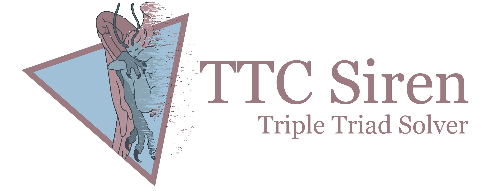

<div align="center">
  
</div>

# TTC_Siren

面向《最终幻想 XIV》九宫幻卡的自动对战求解器。项目提供一个本地 Flask AI 服务，将客户端识别到的棋盘、手牌、规则信息转换为可执行的出牌建议。

当前核心目标不是给出“看起来分高”的一步棋，而是在隐藏手牌、加算/同数、同类强化、残局反制等复杂局面下尽量减少误判。

## 核心能力

- **Minimax + Alpha-Beta 搜索**：主路径使用迭代加深、置换表、历史启发和走法排序；搜索由 **C# 求解引擎**完成（与 Python 版逐位一致，约快 100 倍），服务启动时自动拉起。
- **信息集残局求解**：空位较少且未知牌不超过 2 张时，构造多个可能世界并完整搜索到终局。
- **合法未知牌枚举**：残局优先从全卡库枚举符合当前已知信息的候选，排除已出现卡牌，并应用卡组限制。
- **隐藏手牌建模**：前中局使用规则相关采样，高风险局面会扩大对手候选池。
- **规则适配评估**：支持基础翻面、同数、加算、逆转、王牌杀手、同类强化/弱化、秩序、混乱等规则。
- **服务端实时速度显示**：控制台输出搜索深度、节点数、NPS、置换表命中率、剪枝率和残局信息集进度。
- **HTTP 接口集成**：客户端只需 POST 当前局面，即可获取推荐卡牌和放置位置。

## 支持的规则

当前代码重点支持：

| 规则 | 状态 |
| --- | --- |
| 基础大小翻面 | 支持 |
| 同数 / 加算 | 支持，特殊翻面后才触发连携 |
| 逆转 | 支持 |
| 王牌杀手 | 支持，且仅处理 1 与 A(10) 的特殊克制 |
| 同类强化 / 同类弱化 | 支持，场上同类型卡牌数量决定修正层数 |
| 全明牌 / 三明牌 | 支持输入侧明牌/未知牌建模 |
| 秩序 / 混乱 | 支持 `canUse` 手牌可用性 |
| 选拔 | 有采样建模，仍建议结合实战验证 |

卡组限制按官方规则处理：**★4 以上卡牌合计不超过 2 张，★5 卡牌最多 1 张**。

## 求解流程

1. 服务端解析客户端传入的棋盘、我方手牌、对手手牌、当前玩家和规则。
2. 已知卡牌通过四边数值匹配数据库 ID，未知牌用 `0,0,0,0` 表示。
3. 前中局使用 Minimax 搜索，并对未知牌进行规则相关采样。
4. 进入残局时，如果满足空位较少且未知牌不超过 2 张：
   - 从全卡库枚举合法未知牌候选。
   - 按当前棋盘威胁排序并构造有限数量的信息集场景。
   - 对每个我方候选走法在所有场景中搜索到终局。
   - 按安全比例、最坏收益和综合收益覆盖标准搜索结果。
5. 返回推荐卡牌、位置、对手手牌分析、胜率估计和性能统计。

## 快速开始

### 直接使用（发给别人用的版本）

解压发布包（`scripts\build_release.bat` 生成的 `TTC_Siren_release.zip`），双击 `TTC_Siren.exe`。不需要安装 Python 或 .NET。
服务监听 `http://127.0.0.1:5000`，插件按原来的方式连接即可（无需密钥）；`engine\` 文件夹里的 C# 引擎会被自动启动和关闭，必须和 `TTC_Siren.exe` 放在一起。

### 从源码运行

环境：Windows，Python 3.8+（或 PyPy），构建引擎需要 .NET 10 SDK。

```bash
pip install -r requirements.txt
run_local.bat            # 第一次会先构建 C# 引擎，然后运行 python app.py
```

也可以照旧运行 `python app.py`、`python serve_waitress.py` 或 `scripts\run_pypy.bat`：引擎构建过一次（`scripts\build_engine.bat`）之后，服务会自己启动它。
不想用 C# 引擎时设置环境变量 `TTC_CS_ENGINE=off`（使用原来的 Python 搜索，约慢 100 倍）。

默认监听：

```text
http://127.0.0.1:5000
```

响应会包含推荐卡牌、落点、胜率估计、对手手牌分析和性能统计。部署与引擎设置见 `docs/DEPLOY_WINDOWS.md`，接口见 `API.md`。

### 打包

| 命令 | 产物 |
| --- | --- |
| `scripts\build_release.bat` | 最小可用版：`dist\release\`（`TTC_Siren.exe` + `engine\`）和 `dist\TTC_Siren_release.zip` |
| `build_all.bat` | 全部：`dist\engine\`（C# 引擎）、`dist\TTC_Siren.exe`（CPython）、`dist\TTC_Siren_PYPY\`（PyPy） |

## 数据文件

主要数据位于 `data/`：

| 文件 | 说明 |
| --- | --- |
| `幻卡数据库.csv` | 服务端主要卡牌数据库 |
| `TripleTriadCard.csv` | 原始/参考卡牌数据 |
| `TripleTriadCardResident.csv` | 原始/参考常驻数据 |

数据库核心字段：

| 字段 | 说明 |
| --- | --- |
| `序号` | 卡牌 ID |
| `Top` | 上边数值 |
| `Right` | 右边数值 |
| `Bottom` | 下边数值 |
| `Left` | 左边数值 |
| `星级` | 卡牌星级 |
| `TripleTriadCardType` | 卡牌类型，用于同类规则 |

## 测试

```bash
python -m pytest -q                                   # Python 回归测试（含 C# 引擎桥接与自动启动）
dotnet test csharp/TTC.Siren.sln -c Release           # C# 引擎：单元测试 + 与 Python 逐位一致的 parity 测试
```

当前测试覆盖重点：

- 未知手牌槽位数量不膨胀。
- 同数/加算翻面和连携判定。
- 同类强化/弱化修正层数。
- 王牌杀手与逆转交互。
- 残局信息集安全选择。
- 合法未知牌候选的星级限制过滤。
- C# 引擎与 Python 求解结果逐位一致（分数按 IEEE-754 位比较）。

## 项目结构

```text
TTC_Siren/
├── app.py                      # 服务入口（Flask，127.0.0.1:5000）
├── ai_server.py                # /ai_move 等接口与求解流程
├── serve_waitress.py           # 可选：用 waitress 运行同一服务
├── console_ui.py, csv_compat.py
├── draft_analyzer_app.py       # 选拔分析演示
├── npc_deck_recommender_demo.py# NPC 卡组推荐演示
├── ai/                         # 搜索、评估、蒙特卡洛、未知牌处理、C# 引擎客户端与自动启动
├── core/                       # Card / Board / GameState / Player
├── config/                     # 未知牌采样配置
├── data/                       # 幻卡数据库
├── csharp/                     # C# 求解引擎（Core / Search / Engine）、Bench 与测试
├── tests/                      # Python 回归测试
├── tools/                      # 基准测试、parity golden 生成、压测脚本
├── scripts/                    # 构建与 PyPy 脚本（build_release / build_engine / build_exe / build_exe_pypy / install_pypy / run_pypy）
├── assets/                     # 图标
├── docs/                       # 规则说明、部署指南；docs/migration/ 是 C# 迁移的记录（报告、审查、计划）
├── run_local.bat               # 一键从源码运行
├── build_all.bat               # 打包全部版本
├── API.md                      # HTTP 接口
├── CLAUDE.md                   # 给 Claude 会话的工作规范
└── README.md
```

## 当前限制

- 主 Minimax 仍是单进程搜索；实时 NPS 可观察性能，但尚未使用多进程并行根节点。
- 未知牌信息集会从合法候选池中按风险截断，避免全组合爆炸；它不是无上限的全卡库笛卡尔积搜索。
- 胜率和推荐文案是辅助信息，最终可信度以实际棋盘规则执行和终局搜索结果为准。
- 客户端识别错误会直接影响 AI 判断，尤其是 owner、当前回合、`canUse` 和规则文本。

## 免责声明

本项目用于学习、研究和本地自动化测试。幻卡规则与游戏客户端行为以《最终幻想 XIV》实际版本为准。AI 建议不能保证胜率，实战中仍可能受到未知牌、识别误差和时间限制影响。
